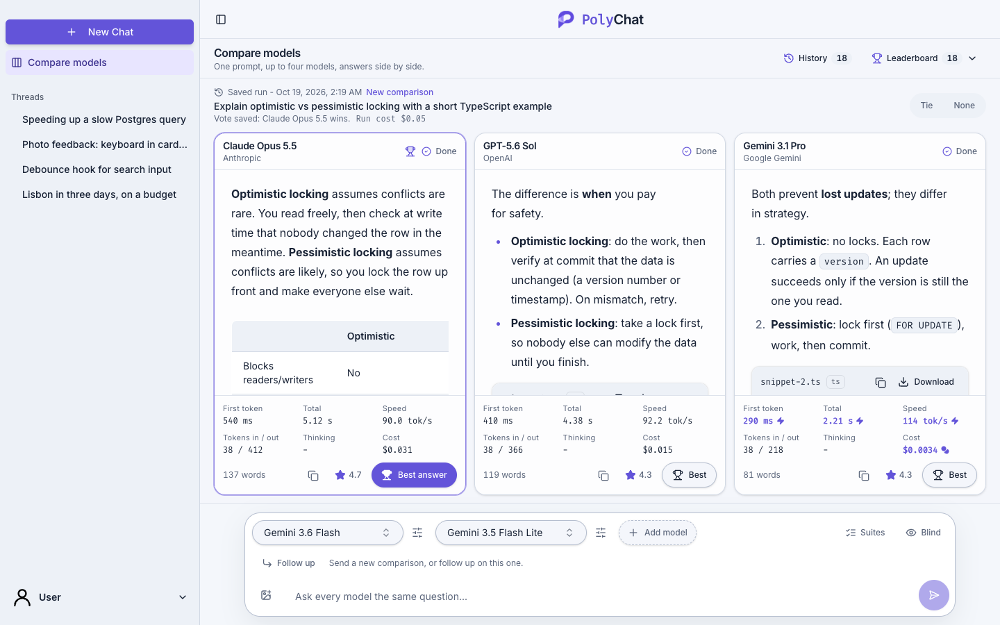
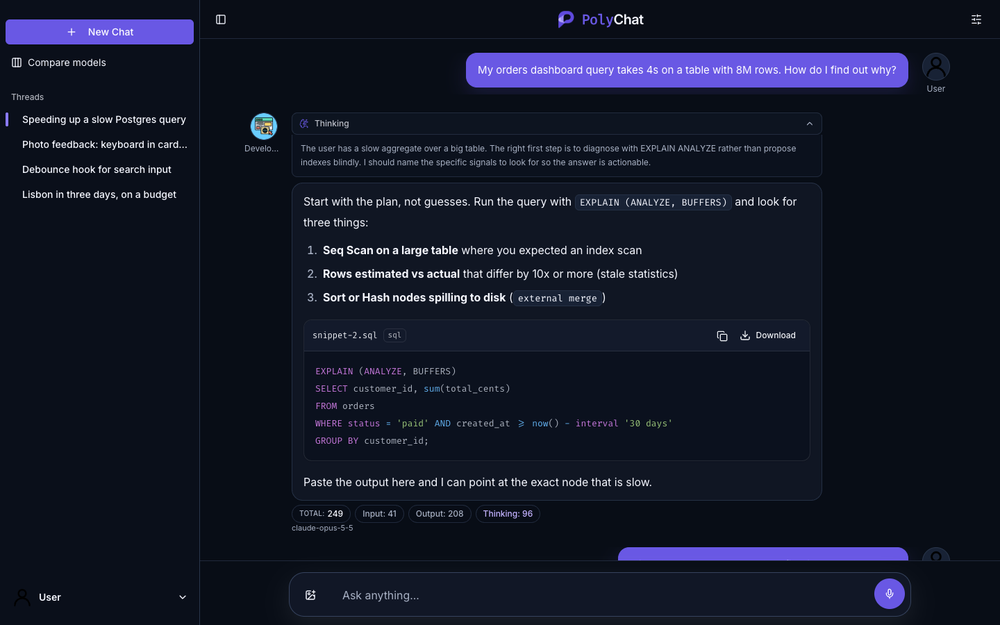
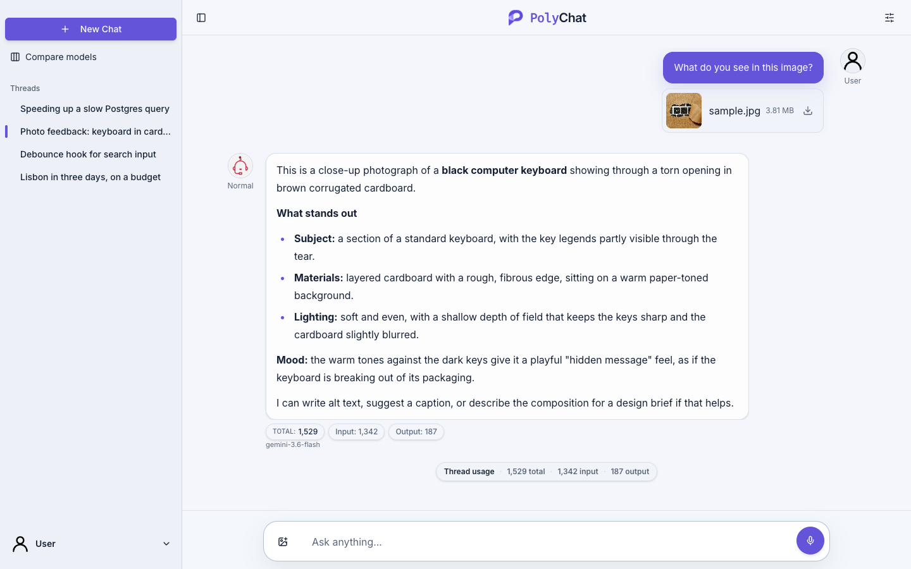
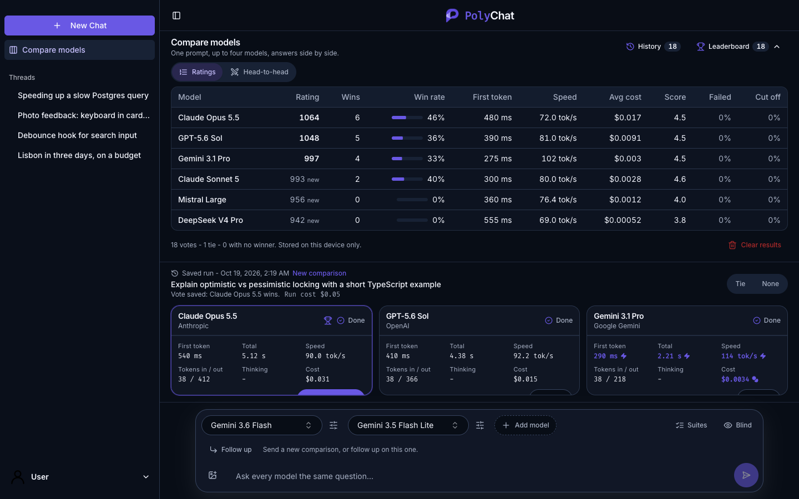
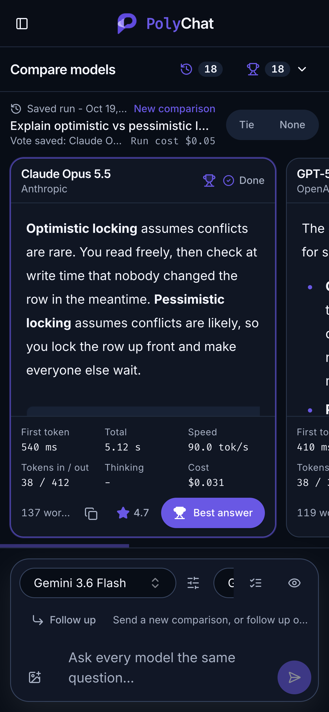
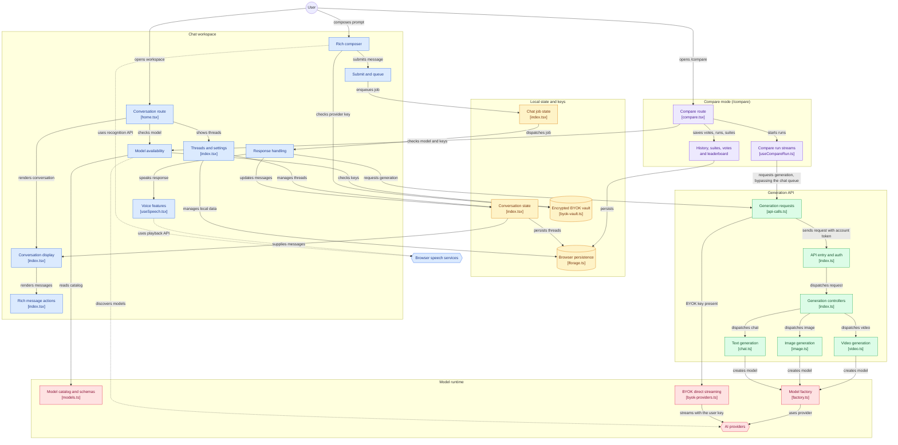

# PolyChat

PolyChat is a focused workspace for thinking, creating, and working with AI.



## Screenshots

| Chat with reasoning and rich Markdown                                                                                               | Vision analysis                                                                                |
| ----------------------------------------------------------------------------------------------------------------------------------- | ---------------------------------------------------------------------------------------------- |
|  |  |

| Compare leaderboard                                                                                                         | Compare on mobile                                                                                                                            |
| --------------------------------------------------------------------------------------------------------------------------- | -------------------------------------------------------------------------------------------------------------------------------------------- |
|  |  |

## Features

- **Compare models side by side** - Send one prompt to two to four text models at once and watch the answers stream in parallel. Each answer shows time to first token, total time, input/output tokens, and cost. Vote for the best answer (or call a tie) to build a local leaderboard of wins, runs, and win rate per model.
- **Run compare experiments** - Override temperature, max output tokens, and profile per slot, take 1-3 samples per slot, attach up to four images, and continue with follow-up turns. Judge blind, rate answers with a correctness, clarity, and conciseness rubric, and retry a failed column without rerunning the others.
- **Save prompt suites** - Store up to 20 prompts as a suite and run them in sequence against the selected models. Browse run history, filter by suite run, view a per-model summary, and export runs as JSON or CSV.
- **Choose the right model** - Switch between supported language, image, and video models from a single conversation workspace.
- **Tune each thread** - Choose a supported model, assistant profile, response language, and whether to send previous messages as multi-turn context.
- **Use focused profiles** - Switch between Normal, Developer, Snarky Bot, Grammar Corrector, Doctor, Teacher, Historian, Chef, Data Scientist, Legal Advisor, and Custom profiles.
- **Personalize responses** - Save up to 4,000 characters of custom instructions locally and use them with the Custom profile.
- **Inspect usage** - Enable detailed token counts for individual messages and the active thread.
- **Keep your work close** - Store threads, messages, generated images, preferences, and custom instructions locally in your browser.
- **Manage local data** - Rename or delete individual threads, delete all chats, or reset all local data from Settings.
- **Bring your own keys** - Use Google Gemini, OpenAI, Anthropic, Mistral, DeepSeek, or OpenRouter keys through a browser-local session key or encrypted vault. Adding a key discovers the models available to it from that provider.
- **Keep chatting while answers stream** - Send messages in several threads; requests queue and keep streaming in the background while you switch between threads.
- **Write and read naturally** - Use a responsive TipTap composer, voice input, and speech playback where your browser supports them.
- **Work with rich answers** - Stream Markdown responses with tables, links, lists, syntax-highlighted code, copy actions, and downloadable files. Open a message context menu to copy, share, copy images, or delete messages with confirmation.
- **Create visuals** - Generate images from prompts, choose supported image options, and download the results. Generate short videos through an OpenRouter key, with duration, resolution, aspect ratio, and audio options where the model supports them.
- **Add image and document context** - Attach images or PDF, DOC, DOCX, TXT, Markdown, CSV, and JSON files to models that advertise file support. Unsupported models show a clear validation message instead of sending.
- **Stay comfortable anywhere** - Light, dark, and system themes, keyboard-friendly controls, and layouts that adapt from desktop to mobile.

## Built with

PolyChat is a local-first React application backed by a small authenticated API:

- React 19, React Router 7, TypeScript 7, and Tailwind CSS 4
- TipTap, Jotai, shadcn, and Radix UI for the interface
- Clerk for authentication
- Vercel AI SDK 7 with Google, OpenAI, Anthropic, Mistral, DeepSeek, and OpenRouter provider integrations
- Hono, Node.js 22, and AWS Lambda for authenticated chat, image, and video requests
- IndexedDB via localForage for local threads, images, compare votes, run history, suites, and the encrypted BYOK vault

## Architecture



The diagram covers the chat workspace, compare mode, local persistence, the generation API, and the model runtime. Compare mode (`/compare`) reuses the same generation requests but runs its streams independently of the chat queue and threads; only votes, run history, and prompt suites are persisted. With a BYOK key, requests stream from the browser straight to the provider instead of through the API.

## BYOK vault and device unlock

BYOK provider keys are managed in the browser. PolyChat does not store the vault or its
passphrase on the server. The vault is persisted in IndexedDB through localForage and is
scoped to the signed-in Clerk account.

The vault uses envelope encryption:

1. Provider keys are encrypted with a randomly generated AES-GCM vault key.
2. The vault key is wrapped with a passphrase-derived AES-GCM key using PBKDF2-SHA-256
   with 600,000 iterations.
3. When the browser and authenticator support WebAuthn PRF, the vault key is also wrapped
   with a device-derived key. Device unlock requires HTTPS, user verification, and a
   discoverable passkey on the current relying-party hostname.

Unlock first attempts the device-wrapped key and falls back to the passphrase-wrapped key.
The passphrase is therefore a recovery mechanism, not something required on every unlock
when device PRF is available. After a successful unlock, the vault stays available for
the lifetime of the browser tab, including file-picker transitions and reloads. PolyChat
stores a tab-scoped copy of the vault key in `sessionStorage` so it can reopen the
encrypted IndexedDB vault after a reload; provider keys remain encrypted at rest. The
session record is cleared when the tab session ends, when the active account changes, or
when the vault is reset. Anyone with access to the still-open browser tab can use the
unlocked BYOK session.

In an installed PWA, the app window acts like a browser tab for this purpose. Reloading
the PWA keeps the session unlock, while closing the PWA window clears it. Mobile operating
systems may terminate or restore PWA processes in the background, so a later relaunch may
require unlocking again if the browser ends the underlying page session.

WebAuthn passkeys used for ordinary website login are not equivalent to PolyChat device
unlock. Standard passkey login returns a server-verifiable assertion, while PolyChat needs
the WebAuthn PRF extension to derive local encryption-key material. Password managers such
as Bitwarden or Apple Passwords may store and present a passkey for standard login without
supporting PRF for vault unlock. When PRF is unavailable, PolyChat keeps passphrase recovery
available. Losing both the device credential and the vault passphrase makes the encrypted
provider keys unrecoverable by design.

## Browser support

PolyChat works in current evergreen browsers. Voice input depends on browser speech-recognition support, while voice playback depends on the Web Speech API and the voices installed on your device.

## Local Development

PolyChat uses Node.js 22.12+, pnpm 11+, a Clerk development instance, and at least one supported AI provider key for server-backed chat. Native local development uses Hono directly so responses stream exactly as they do in the client. Docker and AWS SAM are not required for this workflow.

### 1. Install prerequisites

- Node.js 22.12 or newer
- pnpm 11 or newer
- A Clerk development application
- At least one provider key for Gemini, OpenAI, Anthropic, Mistral, or DeepSeek if you are using the server-backed API. Signed-in users can alternatively configure a supported provider key through the browser-local BYOK settings.

Install workspace dependencies from the repository root:

```bash
pnpm install
```

### 2. Create local test environment files

Test credentials are deliberately separate from any deployed or personal local configuration. Copy the templates, then edit the ignored files:

```bash
cp apps/client/.env.test.example apps/client/.env.test
cp apps/serverless/.env.test.example apps/serverless/.env.test
```

Configure `apps/client/.env.test`:

```dotenv
VITE_API_ENDPOINT=/api
VITE_CLERK_PUBLISHABLE_KEY=pk_test_your_clerk_publishable_key
```

Configure `apps/serverless/.env.test`:

```dotenv
PORT=3001
CLERK_ISSUER_BASE_URL=https://your-clerk-instance.clerk.accounts.dev
CLERK_AUTHORIZED_PARTIES=http://localhost:3000

# Supply only the providers you intend to use locally.
GEMINI_API_KEY=your_key
OPENAI_API_KEY=
ANTHROPIC_API_KEY=
MISTRAL_API_KEY=
DEEPSEEK_API_KEY=
OPENROUTER_API_KEY=
```

`CLERK_AUTHORIZED_PARTIES` must be an exact comma-separated list of frontend origins, including protocol and port. For the default local client, use `http://localhost:3000`.

### Production API proxy security

Production requests should use the Pages `/api` proxy, with `VITE_API_ENDPOINT=/api`. Use [`apps/client/.dev.vars.example`](apps/client/.dev.vars.example) as the reference for the Pages Function runtime bindings: set `API_ORIGIN` to the Lambda Function URL and create an encrypted Pages secret named `LAMBDA_PROXY_SECRET`. Set the same random value in `apps/serverless/.env` before running the serverless deploy script. The Lambda rejects requests that do not carry the secret injected by the Pages Function.

### 3. Start the app

Run the client and streaming local API together:

```bash
pnpm dev:local
```

Open <http://localhost:3000>, sign in through Clerk, and send a message using a model backed by one of the configured provider keys. The client runs on port 3000 and calls the native streaming Hono API on port 3001.

To run each process separately:

```bash
pnpm client:dev:test
pnpm serverless:dev:test
```

### Streaming behavior

`pnpm serverless:dev:test` starts the Hono application through Node's HTTP server. It preserves the `/chat` newline-delimited JSON response stream, so token updates appear in the client as they arrive.
